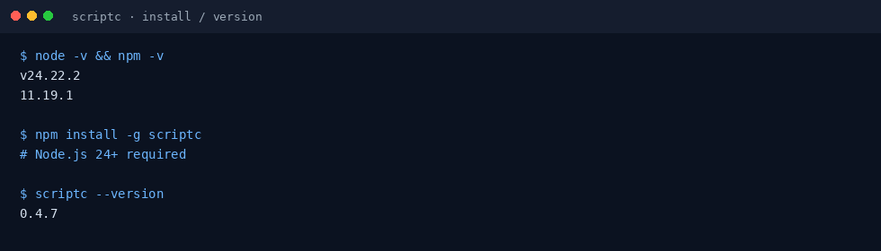
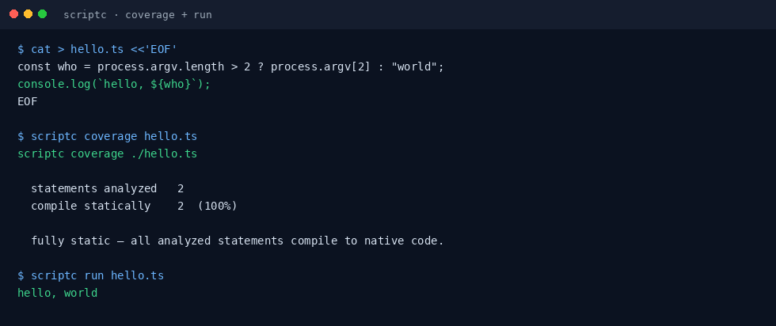
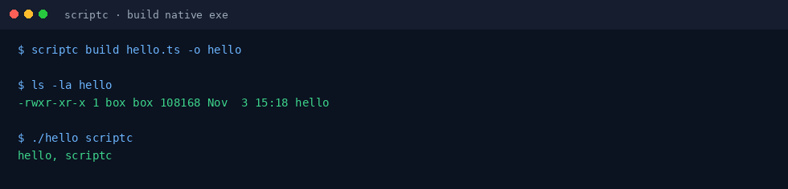

# scriptc 小白中文教程

> 把 TypeScript / JavaScript **编译成无需 Node 的原生可执行文件**（实验性；社区非官方教程）  
> 上游：[`vercel-labs/scriptc`](https://github.com/vercel-labs/scriptc) · 文档：[scriptc.dev](https://scriptc.dev)  
> 教程校对：2026-11-03（Asia/Shanghai）· 本机实测 **scriptc 0.4.7**（Node v24.22.2 · linux_amd64）

[](https://github.com/xianyu110/awesome-scriptc-zh)
[](https://github.com/vercel-labs/scriptc)
[](LICENSE)
[](https://xianyu110.github.io/awesome-scriptc-zh/)

---

## 截图索引

| # | 文件 | 类型 | 说明 |
|---|------|------|------|
| 1 | [`images/01-install.png`](images/01-install.png) | **真实** | `npm i -g scriptc` 后 `scriptc --version` → 0.4.7 |
| 2 | [`images/02-coverage-run.png`](images/02-coverage-run.png) | **真实** | `scriptc coverage` 100% + `scriptc run hello.ts` |
| 3 | [`images/03-build-native.png`](images/03-build-native.png) | **真实** | `scriptc build` 产出原生 `./hello`，无需 Node 即可运行 |

> 真实截图在 Linux x86_64 沙盒采集。原生链接需要系统 **clang**（或兼容驱动）与平台 SDK；见官方 [quickstart](https://scriptc.dev/docs/quickstart) / [platforms](https://scriptc.dev/docs/platforms)。

---

## 这是什么？

**scriptc**（Vercel Labs，实验性）用 TypeScript 编译器已检查的类型信息，把 TS/JS（及能编译的 npm 依赖）编成**机器码可执行文件或 WebAssembly**。运行产物时**不必再安装 Node.js**（安装编译器本身仍需 Node 24+；`scriptc run` 在跑 WASI 时仍可能用到 Node）。

典型用法：

1. `npm install -g scriptc`
2. 写 `hello.ts`，先 `scriptc coverage` 看能编多少
3. `scriptc run hello.ts` 编译并运行
4. `scriptc build hello.ts -o hello` 得到独立可执行文件

本仓库只提供**中文小白教程**（MIT），不二次分发上游二进制。上游许可证为 **Apache-2.0**。

---

## 官方链接（请以官方为准）

| 资源 | 链接 |
|------|------|
| 源码 | https://github.com/vercel-labs/scriptc |
| 官网 / 文档 | https://scriptc.dev |
| Quickstart | https://scriptc.dev/docs/quickstart |
| CLI 参考 | https://scriptc.dev/docs/cli |
| 限制与兼容 | https://scriptc.dev/docs/limitations · https://scriptc.dev/compatibility |
| Releases | https://github.com/vercel-labs/scriptc/releases |

---

## 环境要求（摘要）

- **Node.js 24 或更高** + npm（官方安装方式）
- **macOS / Linux / Windows** 原生编译器；构建可执行文件需要 **链接器与平台 SDK/sysroot**（Linux 常见为 clang）
- 也可用 [GitHub Releases](https://github.com/vercel-labs/scriptc/releases) 的独立编译器归档
- 项目为**实验性**，仅支持 JS/TS/Node API 子集；命令以你本机 `scriptc --help` 与官方文档为准

---

## 安装（macOS / Windows / Linux）

### 方式 A：npm 全局安装（推荐）

```bash
# 需要 Node.js 24+
npm install -g scriptc
scriptc --version
```



### 方式 B：Release 归档

到 [Releases](https://github.com/vercel-labs/scriptc/releases) 下载对应平台包（如 `scriptc-*-linux-x64-gnu.tar.gz`），解压后把二进制加入 `PATH`。细节见官方 Quickstart。

Windows 上构建产物一般为 `hello.exe`，运行用 `.\hello.exe`。

---

## 第一次演示任务（约 5 分钟）

创建官方同款 `hello.ts`：

```ts
const who = process.argv.length > 2 ? process.argv[2] : "world";
console.log(`hello, ${who}`);
```

先看覆盖率，再运行：

```bash
scriptc coverage hello.ts
scriptc run hello.ts
```



编译成原生可执行文件（产物运行**不需要** Node）：

```bash
scriptc build hello.ts -o hello >/dev/null
./hello scriptc
# Windows: scriptc build hello.ts -o hello.exe && .\hello.exe scriptc
```



更多示例（HTTP server、npm 包如 `picocolors`）见上游 README。若某段代码编不过，用 `scriptc coverage` 看诊断，并查阅 [limitations](https://scriptc.dev/docs/limitations)。

---

## 常见报错与解决

| 现象 | 可能原因 | 处理 |
|------|----------|------|
| 安装失败 / 引擎不符 | Node &lt; 24 | 升级到 Node 24+（可用 fnm / nvm） |
| `spawnSync clang ENOENT` | 缺少 clang | 按官方 platforms/quickstart 安装 clang 与 SDK |
| 链接失败 / SDK 缺失 | 未装系统开发工具 | macOS Xcode CLT；Linux 安装 build-essential/clang |
| 覆盖率很低 | 用了未支持的 API | 改写或查阅 compatibility；实验性属正常 |
| `scriptc: command not found` | 未进 PATH | 确认 npm 全局 bin 目录在 PATH |

---

## 许可证与合规

- **本教程文字与配图**：MIT（见 [LICENSE](LICENSE)）
- **上游 scriptc**：Apache-2.0；请自行阅读其依赖与 NOTICE
- 本教程**不硬推**未备案境外模型或 API 中转；scriptc 本身是本地编译工具，与模型接入无关
- 店铺仅 [MaynorAI](https://wzyp.cn/shop/maynorai)

与 Vercel / vercel-labs **无隶属关系**。价格、配额、云服务条款以各官方页面为准。

---

## GitHub Pages

图文镜像页：https://xianyu110.github.io/awesome-scriptc-zh/
